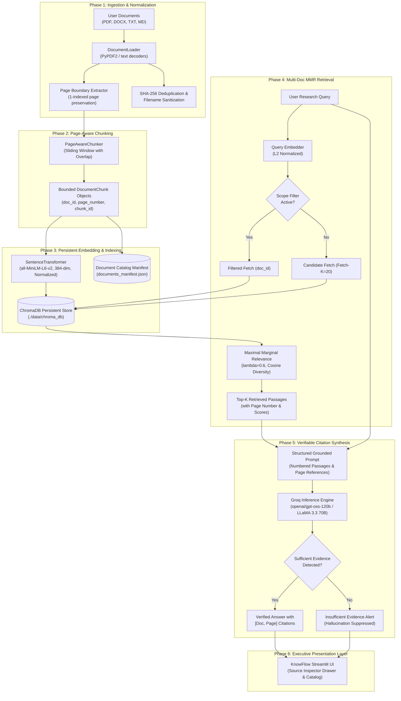

# 🏗️ KnowFlow AI — System Architecture & Technical Specification

## Overview

**KnowFlow AI** is an intelligent, high-reliability document research assistant designed to answer multi-document queries with verifiable, page-level grounded citations while eliminating hallucinations and silent data loss.

---

## 1. End-to-End Pipeline Architecture



---

## 2. Deep Dive: Component Technical Specifications

### 2.1 Document Ingestion & Page Normalization (`src/knowflow/core/document_loader.py`)
- **Objective**: Ingest heterogeneous document formats while preserving page boundaries, Unicode characters, and security invariants.
- **Page Boundary Extraction**:
  - PDFs are processed page-by-page using `PyPDF2.PdfReader`. Every page is extracted into an independent `DocumentPage` object maintaining a strict `1-indexed` page number.
  - Plain text (`.txt`) and Markdown (`.md`) files utilize multi-encoding resolution (`utf-8-sig` -> `utf-8` -> `latin-1` -> `cp1252`) to guarantee that international currency signs (e.g., Indian Rupee `₹`, Euro `€`), foreign scripts (Devanagari, Tamil, Chinese), and mathematical symbols remain uncorrupted.
- **Security & Deduplication**:
  - Filenames are sanitized via regex `[^\w\s\.\-]` to completely neutralize directory traversal attacks (`../../etc/passwd`).
  - SHA-256 hashes are computed on the raw file bytes for exact deduplication.
  - File size limits (default 25 MB) and empty file checks guard against resource exhaustion.

---

### 2.2 Page-Aware Sliding Window Chunker (`src/knowflow/core/chunker.py`)
- **Problem Solved**: The reference codebase executed `text[:6000]` before chunking, causing silent data loss for any content past ~1,000 words.
- **KnowFlow Solution**:
  - The `PageAwareChunker` iterates over every page of the document without arbitrary cutoffs.
  - Chunks are formed using sentence/clause-aware splitting with a target chunk size (default: 600 characters) and overlapping sliding window (default: 120 characters).
  - Every resulting `DocumentChunk` object stores:
    - `chunk_id`: Formatted as `{doc_id}_p{page_number}_c{chunk_index}`
    - `doc_id`: Unique document identifier
    - `filename`: Human-readable source name
    - `page_number`: 1-indexed originating page number
    - `chunk_index`: Sequence offset within the document
    - `text`: Chunk body

---

### 2.3 Persistent Vector Storage & Cataloging (`src/knowflow/core/vector_store.py`)
- **Problem Solved**: Ephemeral in-memory ChromaDB wiped all vectors whenever the app restarted, and document deletion was desynchronized.
- **KnowFlow Solution**:
  - Uses `chromadb.PersistentClient(path="./data/chroma_db")` to guarantee that vector embeddings, metadata, and index structures persist across process reboots.
  - **Atomic Deletion**: Calling `delete_document(doc_id)` performs a vector purge from ChromaDB via `collection.delete(where={"doc_id": doc_id})` and synchronizes the local JSON catalog (`documents_manifest.json`).
  - **Batch Embedding**: Uses Sentence Transformers (`all-MiniLM-L6-v2`, 384 dimensions) with `normalize_embeddings=True` in configurable batches.

---

### 2.4 Maximal Marginal Relevance (MMR) Retrieval (`src/knowflow/core/retriever.py`)
- **Objective**: Retrieve passages that maximize query relevance while penalizing redundant, near-identical passages.
- **Formulation**:
  $$\text{MMR} = \operatorname*{argmax}_{d_i \in R \setminus S} \left[ \lambda \cdot \operatorname{Sim}(d_i, q) - (1 - \lambda) \cdot \max_{d_j \in S} \operatorname{Sim}(d_i, d_j) \right]$$
  where:
  - $q$ is the unit-normalized query vector.
  - $R$ is the candidate set fetched from ChromaDB ($K_{\text{fetch}} = 20$).
  - $S$ is the set of already selected diverse chunks ($K_{\text{top}} = 4$).
  - $\lambda = 0.6$ balances relevance against redundancy.
- **Scope Scoping**: Supports restricting search to a specific document (`doc_filter`) or searching globally across all indexed documents.

---

### 2.5 Grounded Citation Generator & Evidence Safeguards (`src/knowflow/core/generator.py`)
- **Prompt Engineering**:
  - Retrieved passages are formatted into labeled context blocks:
    ```
    [Passage 1]
    Document: techcorp_financial_q3.txt
    Page: 1
    Relevance: 0.82
    Content: ...
    ```
  - The system prompt enforces:
    1. Answers must be derived **STRICTLY** from the provided passages.
    2. Every key factual claim must attach an inline citation: `[Doc: <filename>, Page: <page>]`.
    3. If evidence is inadequate, the assistant must declare: *"Based on the provided documents, there is insufficient evidence to answer this question."*
- **Insufficient Evidence Guard**:
  - Regex and keyword scanning inspect model outputs against known hallucination signals.
  - Low cosine relevance scores combined with negative queries trigger an explicit visual warning pill in the UI.

---

### 2.6 Empirical Evaluation Framework (`src/knowflow/eval/evaluator.py`)
- **Decoupled Architecture**: Completely separate from the Streamlit UI, allowing automated continuous integration testing.
- **Empirical Metrics**:
  - **Retrieval Recall@K**: Did top-K chunks contain the ground-truth document and page?
  - **Citation Accuracy**: Did the LLM cite the exact ground-truth document and page number?
  - **Token F1**: Token-level precision/recall overlap with ground-truth reference answers.
  - **Negative Hallucination Resistance**: Accurate classification and refusal on out-of-domain/unanswerable queries.
  - **Latency Profiling**: Millisecond-precision measurement of vector retrieval vs LLM inference.
