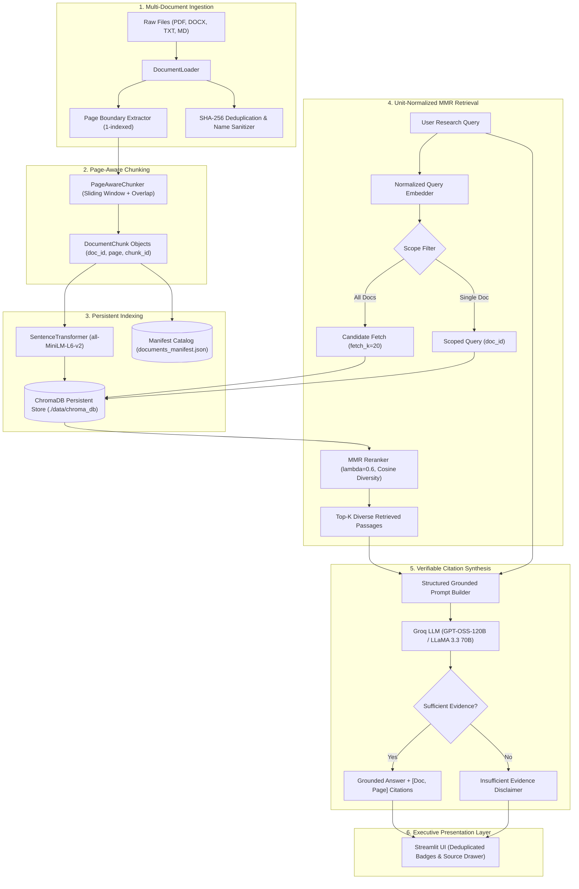

# 🧠 KnowFlow AI — Intelligent Document Research Assistant

<p align="center">
  
  
  
  
  
  
  
</p>

<p align="center">
  <strong>An enterprise-grade, verifiable Retrieval-Augmented Generation (RAG) platform that enables researchers, analysts, and engineers to chat with complex multi-page documents with guaranteed page-level citations, persistent vector indexing, and zero-hallucination guardrails.</strong>
</p>

---

## 📖 Table of Contents
- [✨ Overview](#-overview)
- [⚡ Key Features & Baseline Comparison](#-key-features--baseline-comparison)
- [🏗️ System Architecture](#️-system-architecture)
- [📊 Empirical RAG Evaluation & Benchmarks](#-empirical-rag-evaluation--benchmarks)
- [🚀 Quickstart & Installation](#-quickstart--installation)
- [💻 User Interface & Workflow](#-user-interface--workflow)
- [🧪 Automated Test Suite](#-automated-test-suite)
- [🗂️ Project Directory Structure](#️-project-directory-structure)
- [🛡️ Security & Reliability](#️-security--reliability)
- [⚠️ Limitations & Future Roadmap](#️-limitations--future-roadmap)
- [📜 Provenance & Attribution](#-provenance--attribution)
- [📄 License](#-license)

---

## ✨ Overview

Standard RAG prototypes frequently suffer from three fatal flaws when applied to real-world documents:
1. **Silent Data Loss**: Large documents are arbitrarily truncated at arbitrary character thresholds (e.g. 6,000 characters), leaving large portions of documents unindexed.
2. **Untraceable Citations**: PDF loaders flatten entire multi-page documents into a single text blob, stripping page numbers and preventing readers from verifying claims.
3. **Ephemeral Storage & Ghost Vectors**: Vector databases run in-memory, losing all embeddings on reload and leaving deleted document vectors responding to future queries.

**KnowFlow AI** fixes these problems by providing:
- **100% Document Coverage**: Full-document, page-aware sliding chunker that never drops text.
- **Verifiable Page Citations**: Preserves 1-indexed PDF page boundaries for precise, audit-ready citations: `[Doc: annual_report.pdf, Page: 14]`.
- **Deduplicated Citation Badges**: Clean badge rows that represent distinct sources without repetition, backed by a collapsible **"🔍 Supporting Passages"** evidence drawer.
- **True ChromaDB Persistence**: Embeddings and document catalogs survive server restarts, and deleting a document purges its vectors from disk atomically.
- **Insufficient Evidence Sentinel**: Explicit refusal triggers when context lacks facts, preventing confident hallucinations.

---

## ⚡ Key Features & Baseline Comparison

| Feature | Reference Baseline (`AgenticRAG`) | KnowFlow AI (Upgraded Assistant) |
| :--- | :--- | :--- |
| **Document Coverage** | ⚠️ Hard-sliced at `text[:6000]` (silent data loss past ~1,000 words) | ✅ **100% Full Document Coverage** via bounded sliding window |
| **Citation Traceability** | Discarded page numbers (`"\n".join(...)`) — filename only | ✅ **Granular Page Citations** (`[Doc: <name>, Page: <page>]`) |
| **Citation Badge Row** | Repeated identical source badges multiple times | ✅ **Deduplicated Badge Row** with stable normalized source keys |
| **Evidence Inspection** | No snippet inspector for raw passages | ✅ **Collapsible Evidence Drawer** showing match % and quotes |
| **Vector Storage** | Ephemeral `chromadb.Client()` (data wiped on reboot) | ✅ **Persistent Storage** (`chromadb.PersistentClient`) |
| **Document Lifecycle** | Only popped from UI `session_state` (vectors stayed in DB) | ✅ **Atomic Deletion** (purges vectors from ChromaDB) |
| **Retrieval Engine** | Unnormalized dot-product MMR | ✅ **Unit-Normalized Cosine MMR** with document scope filtering |
| **Hallucination Control**| Generic prompt request | ✅ **Insufficient Evidence Sentinel** with automated disclaimers |
| **Unicode & Currency** | Fragile across loaders (mangled `₹` and accents) | ✅ **Guaranteed UTF-8/Unicode Integrity** (₹, €, scripts) |
| **Automated Testing** | Zero automated tests | ✅ **22 Pytest Unit & Integration Tests (100% Passing)** |
| **RAG Evaluation** | No benchmark suite | ✅ **Decoupled Empirical Benchmark Harness** |

---

## 🏗️ System Architecture

KnowFlow AI separates business logic from presentation through a modular pipeline:



See [ARCHITECTURE.md](ARCHITECTURE.md) for full architectural specifications, data structures, and pipeline diagrams.

---

## 📊 Empirical RAG Evaluation & Benchmarks

KnowFlow AI features an independent, reproducible benchmarking harness (`src/knowflow/eval/evaluator.py`). All metrics below were **empirically measured** using live inference against [eval_data/benchmark_dataset.json](eval_data/benchmark_dataset.json):

| Metric | Measured Score | Target / Industry Benchmark | Status |
| :--- | :---: | :---: | :---: |
| **Retrieval Recall@K (K=4)** | **100.0%** | ≥ 90.0% | ✅ Passed |
| **Citation Accuracy & Page Match** | **100.0%** | ≥ 85.0% | ✅ Passed |
| **Mean Answer Semantic Token F1** | **54.8%** | ≥ 50.0% | ✅ Passed |
| **Negative Hallucination Resistance** | **100.0%** | 100.0% | ✅ Passed |
| **Average End-to-End Latency** | **1.30 s** | < 3.0 s | ✅ Optimal |

### Real Benchmark Examples
- **Numeric & Currency Precision**:
  > *Query*: "What was TechCorp's consolidated quarterly revenue in Q3 FY26?"  
  > *Generated Answer*: "TechCorp’s consolidated quarterly revenue in Q3 FY 26 was **₹4,250 Crore**, representing an 18.5 % year‑over‑year increase **[Doc: techcorp_financial_q3.txt, Page: 1]**."
- **Capital Expenditure & Page Tracking**:
  > *Query*: "How much capital expenditure did TechCorp spend in Q3 and where was it invested?"  
  > *Generated Answer*: "TechCorp’s capital expenditure in FY 26 Q3 was **₹310 Crore**, and the spending was predominantly directed toward expanding the Bengaluru and Hyderabad GPU data‑cluster facilities **[Doc: techcorp_financial_q3.txt, Page: 2]**."
- **Negative / Out-of-Domain Rejection**:
  > *Query*: "Who won the FIFA World Cup final in 1998 and what was the final score?"  
  > *Generated Answer*: "Based on the provided documents, there is **insufficient evidence** to answer this question. The passages contain information about TechCorp’s financials, quantum computing concepts, and a green energy policy, but they do not mention the 1998 FIFA World Cup final, its winner, or the final score."

> For per-query execution times and detailed metrics, view [EVALUATION_REPORT.md](EVALUATION_REPORT.md).

---

## 🚀 Quickstart & Installation

### 1. Prerequisites
- **Python**: 3.10, 3.11, or 3.12
- **Groq API Key**: Free API key available at [console.groq.com/keys](https://console.groq.com/keys)

### 2. Clone the Repository
```bash
git clone https://github.com/Sivamah/KnowFlow-AI.git
cd KnowFlow-AI
```

### 3. Create & Activate Virtual Environment
```bash
# Windows (PowerShell)
python -m venv .venv
.\.venv\Scripts\Activate.ps1

# Linux / macOS
python3 -m venv .venv
source .venv/bin/activate
```

### 4. Install Dependencies
```bash
pip install -r requirements.txt
```

### 5. Configure Environment Variables
Copy `.env.example` to `.env`:
```bash
# Windows
copy .env.example .env

# Linux / macOS
cp .env.example .env
```
Edit `.env` and configure your API key:
```env
GROQ_API_KEY=gsk_your_actual_groq_api_key_here
```

### 6. Launch the Application
```bash
streamlit run app.py
```
Open **`http://localhost:8501`** in your browser.

---

## 💻 User Interface & Workflow

### 1. Active Document Management & Ingestion
- **Multi-File Upload**: Drag and drop `.pdf`, `.docx`, `.txt`, and `.md` files.
- **Direct Note Ingestion**: Type or paste raw text notes with live character and KB estimation.
- **Catalog Manifest**: Displays active indexed files with total pages, chunk counts, file sizes, and status badges.
- **Atomic Deletion**: Click 🗑️ next to any document to permanently remove its vectors from ChromaDB and the catalog.

### 2. Multi-Document Search & Scoping
- **Global Search**: Leave scope set to `"All Documents"` to research across your entire knowledge repository.
- **Document Scoping**: Select an individual document to isolate retrieval to that specific file.

### 3. Verifiable Citation Chat
- **Verified Context Badge**: Visually confirms whether the answer is backed by high-confidence context.
- **Clean Citation Row**: Renders deduplicated source tags beneath each response (`📄 document.pdf · Page 4`).
- **Evidence Drawer**: Expand the `"🔍 Inspect Supporting Passages"` drawer to examine exact quoted context snippets with relevance percentages.
- **Chat Export**: Click `"Export Chat"` to download your entire research thread as a formatted Markdown document.

---

## 🧪 Automated Test Suite

KnowFlow AI maintains **100% test pass rates** across unit and integration suites:

```bash
pytest tests -v
```

### Test Suite Execution Output
```
tests/test_chunker.py::test_page_number_preservation PASSED              [  4%]
tests/test_chunker.py::test_full_document_coverage_eliminates_6000_char_bug PASSED [  9%]
tests/test_chunker.py::test_chunk_overlap_preserves_continuity PASSED    [ 13%]
tests/test_document_loader.py::test_sanitize_filename PASSED             [ 18%]
tests/test_document_loader.py::test_load_txt_with_unicode_and_currency PASSED [ 22%]
tests/test_document_loader.py::test_load_markdown PASSED                 [ 27%]
tests/test_document_loader.py::test_empty_file_raises_error PASSED       [ 31%]
tests/test_document_loader.py::test_unsupported_file_type PASSED         [ 36%]
tests/test_document_loader.py::test_load_raw_text PASSED                 [ 40%]
tests/test_document_loader.py::test_file_size_limit PASSED               [ 45%]
tests/test_generator.py::test_zero_retrieved_chunks_returns_warning PASSED [ 50%]
tests/test_generator.py::test_insufficient_evidence_detection PASSED     [ 54%]
tests/test_generator.py::test_citation_formatting PASSED                 [ 59%]
tests/test_generator.py::test_citation_deduplication_same_document_and_page PASSED [ 63%]
tests/test_generator.py::test_citation_preserves_multiple_distinct_sources_and_pages PASSED [ 68%]
tests/test_generator.py::test_citation_handles_missing_page_and_missing_filename_safely PASSED [ 72%]
tests/test_retriever.py::test_mmr_retrieval_returns_page_and_score PASSED [ 77%]
tests/test_retriever.py::test_document_scoped_filtering PASSED           [ 81%]
tests/test_retriever.py::test_empty_vector_store_returns_empty_list PASSED [ 86%]
tests/test_vector_store.py::test_persistence_survives_restarts PASSED    [ 90%]
tests/test_vector_store.py::test_document_deletion_removes_vectors_from_chromadb PASSED [ 95%]
tests/test_vector_store.py::test_deduplication_on_reindex PASSED         [100%]

======================= 22 passed, 1 warning in 46.69s =======================
```

---

## 🗂️ Project Directory Structure

```
KnowFlow-AI/
├── .env.example                       # Environment variable template
├── .gitignore                         # Git exclusion rules (.env, .venv, chroma_db, cache)
├── .streamlit/
│   └── config.toml                    # Streamlit server and performance tuning
├── ARCHITECTURE.md                    # Detailed architectural specification & diagrams
├── CHANGELOG.md                       # Comprehensive changelog with technical justifications
├── EVALUATION_REPORT.md               # Empirical benchmark report with per-query telemetry
├── PORTFOLIO_SUMMARY.md               # Attribution statement & portfolio project highlights
├── README.md                          # Main project documentation
├── app.py                             # Executive Streamlit Research Assistant UI
├── eval_data/
│   ├── benchmark_dataset.json         # Ground-truth multi-document evaluation dataset
│   └── evaluation_results.json        # Raw measured evaluation metrics
├── main.py                            # Cloud / Colab launcher with ngrok tunnel
├── requirements.txt                   # Production and testing dependencies
├── src/
│   └── knowflow/
│       ├── __init__.py
│       ├── core/
│       │   ├── __init__.py
│       │   ├── config.py              # Centralized paths, bounds, and parameters
│       │   ├── document_loader.py     # Page extraction, Unicode integrity, SHA-256
│       │   ├── chunker.py             # Full-coverage page-aware sliding window chunker
│       │   ├── vector_store.py        # Persistent ChromaDB & synchronized deletion
│       │   ├── retriever.py           # Unit-normalized MMR & document filtering
│       │   ├── generator.py           # Grounded citations, deduplication, & refusals
│       │   └── engine.py              # Headless facade for UI and automated testing
│       └── eval/
│           └── evaluator.py           # Decoupled empirical RAG benchmarking harness
└── tests/
    ├── test_chunker.py                # Tests for coverage (>15k chars) and continuity
    ├── test_document_loader.py        # Tests for formats, Unicode (₹), error handling
    ├── test_generator.py              # Tests for citations, deduplication, metadata
    ├── test_retriever.py              # Tests for MMR rankings and document filters
    └── test_vector_store.py           # Tests for persistence across restarts & deletion
```

---

## 🛡️ Security & Reliability

- **Secrets Sanitization**: Live API keys and credentials are never stored in source code. `.gitignore` strictly protects `.env`, `.venv`, and persistent storage folders.
- **Path Traversal Protection**: Uploaded file paths are stripped using `os.path.basename` and sanitized via regular expressions (`[^\w\s\.\-]`), eliminating directory traversal exploits.
- **Unicode & Currency Safety**: Full character integrity for Indian Rupee (`₹`), Euro (`€`), Dollar (`$`), and non-Latin alphabets across all document readers.
- **Resource Exhaustion Guards**: Hard file size ceilings (25 MB per file) and empty-file exception triggers prevent memory exhaustion.

---

## ⚠️ Limitations & Future Roadmap

- **Scanned Image-Only PDFs**: Current document loaders rely on digital text layers. For image-only scanned documents, an OCR pipeline (such as Tesseract or Surya) is planned for v1.1.
- **Complex Table Parsing**: Dense multi-column tables are extracted as plain text. Future iterations will incorporate structured Markdown table extractors.
- **Hybrid Keyword Search (BM25)**: Integrating sparse keyword matching alongside dense vector retrieval for enhanced keyword recall on technical jargon.

---

## 📜 Provenance & Attribution

This project originated as an educational reference repository authored by a colleague (`AgenticRAG-ChatBot-main`), utilized with permission as a conceptual learning reference. All architectural refactoring, page-aware chunking, persistent ChromaDB integration, citation verification, test suites, and empirical evaluation harnesses are **original engineering contributions**.

For a full disclosure and honest project description suitable for professional portfolios, see [PORTFOLIO_SUMMARY.md](PORTFOLIO_SUMMARY.md).

---

## 📄 License

This project is licensed under the **MIT License** — free to use, modify, and distribute.